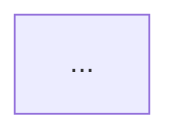

# Writing the business documentation

The release skill's step 4 follows this guide. Write as a **senior business analyst** documenting Travel Ninja for
people who never see the code: the PMO team, the testing team, and the tour operators who use the app. A reader should
finish a page knowing **why the module exists, what it lets them do, how to do each task step by step, and which
business rules apply**.

## Who reads it and what they need

| Reader | What they look for |
|---|---|
| PMO / business stakeholders | What the module is for, who uses it, how it fits the overall business flow |
| Testing team | Every task, rule and message, so they can check the behaviour and know what changed in a release |
| Tour operators (end users) | Step-by-step instructions with screenshots |

## The document set

Keep this structure under `docs-site/docs/`. Create a page when it's missing, otherwise update the page that exists.

| Page | Contents |
|---|---|
| `index.md` (Introduction, `slug: /`) | What Travel Ninja is and the business problem it solves, who uses it, the modules at a glance (a table with one line per module and a link), and the **end-to-end business journey** as a Mermaid flowchart (for example: sign up → verify → log in → create a tour → take bookings → manage customers). |
| `getting-started/` | Account access: creating an account, verifying it, logging in, forgotten and reset passwords. One page per task, or a single `account-access.md` while it's small. |
| `user-guide/<module>.md` | One page per module (Dashboard, Tours, Bookings, Customers, ...). Use the template below. |
| `glossary.md` | Business terms used in the app (Tour, Schedule, Booking, Customer, Status, ...) with one-line definitions. Add terms as modules introduce them. |
| `release-notes.md` | One section per release, newest first (see step 4.5 in `SKILL.md`). |
| `testing/` | Already exists. Leave the content alone unless a release changes how bugs are reported. |

Each folder needs a `_category_.json` (copy `user-guide/_category_.json`). Order pages with `sidebar_position`.
When a page moves or is added, update the links in `index.md` and the footer in `docusaurus.config.ts` if they point to it.

## Module page template

~~~md
---
sidebar_position: <n>
title: <Module name>
---

# <Module name>

<One or two sentences: the business purpose. What problem does this solve for the tour operator?>

**Who uses it:** <roles> · **Where to find it:** <side menu item / how you reach it>


## What you can do here
- <Task 1, as a business outcome: "Find a guest's contact details">
- <Task 2> ...

## <Key information> (for example "The customers table")
<Table: field | what it means for the business. Not data types.>

## How to <task 1>
1. <Numbered steps that use the exact on-screen labels in **bold**>
2. ...


## <Business flow> (only when it earns its place, see "Flowcharts")


## Business rules
- <Validations, limits and behaviours in plain words: "A password needs at least 8 characters, including a number.">

## Messages you might see
| Message | What it means | What to do |

## Related modules
- <Links to modules that feed into or follow from this one>

## Things to check when testing
- [ ] <A short scenario per task and rule, in plain words: "Search for part of a city name: only guests from matching cities appear.">
~~~

Leave out sections that have nothing in them. Don't pad.

## Voice and wording

- Second person, present tense, short sentences: "Click **View** to see the guest's details."
- Use the **exact on-screen labels** in bold, taken from the code (button text, placeholders, headings, messages).
- Explain the business reason where it helps: "Searching takes you back to the first page, so you always see the best matches first."
- Describe what the user sees and does, never how it's built. Translate technical terms:

| Don't write | Write |
|---|---|
| component, page component, route | screen, page |
| modal, dialog | pop-up window |
| drawer | side panel |
| toast, notification | message |
| query params, URL state | the page address (so you can bookmark or share it) |
| validation error, schema | "the form tells you ..." / business rule |
| API, backend, server, database, fetch | "Travel Ninja", "loading", "saving" |
| loading state, skeleton | "while the list loads, you see grey placeholders" |
| error boundary, 500, exception | "Something went wrong" message and what to do |
| enum, boolean, null | the actual choices, yes/no, "not entered" |

## Where the facts come from

Document only what the app really does. Read, for each module:

- `src/app/<module>/` (`page.tsx`, `layout.tsx`, `error.tsx`, forms) and the components it renders from `src/components/`.
- Form schemas (`*Schema.ts`, zod) for business rules: required fields, lengths, formats.
- `src/constants/` for labels, menu items and messages.
- Stories (`*.stories.tsx`) for the states a screen can be in, and tests (`*.test.tsx`) for the behaviour they assert.

If a screen is a placeholder (for example the Dashboard only shows a welcome heading), say plainly what it shows today
and don't invent features. If behaviour is unclear from the code, don't guess: leave it out and list it in the report as
a question for the user.

Keep what people have written by hand. Update pages in place: change only sections the release affects, and add new ones.
Rewrite a whole page only if most of it no longer matches the app.

## Screenshots

Screenshots come from Storybook with `pnpm docs:screenshots` (see `SKILL.md` step 4.3).

- Find a module's stories with `pnpm docs:screenshots --list <module>`. Prefer `screens/*` stories, then the module's
  `components/<Module>` story. Don't screenshot small building-block components (Button, Dropdown, ...).
- Take desktop-size images by default (the `Desktop`/`Default` stories). Add a mobile image only when the layout differs in
  a way a user would notice.
- One image per state worth explaining: the default view, a filtered/search result, empty, error, a form with
  validation messages, a confirmation. These states, in order, are the visual walkthrough of a flow.
- Name images after what they show (`default`, `filtered`, `no-matches`, `empty`), using `<story-id>=<name>` to rename.
- **Look at every image** (Read the PNG) before you use it. Check that it shows the right screen, isn't blank or
  broken, and that the text you write matches what's visible.
- Alt text describes what the reader sees: "Customers list filtered to guests from Chennai", not "screenshot".
- If a screen has no story, write the page without an image and list it in the report as "add a Storybook story for
  <screen> to get screenshots". Don't add stories during a release.

## Flowcharts

Docusaurus renders ` ```mermaid ` code blocks (`SKILL.md` step 4.2 sets this up). Use one when a picture explains more
than a list:

- **The end-to-end business journey** on the Introduction page (always).
- **Multi-step flows with decisions**: sign up → verify (code correct? resend?) → log in; forgot → email → reset.
- **Lifecycles**: a booking's statuses, using `stateDiagram-v2`.
- **How modules connect**: tours → bookings → customers.

Not for a single screen of look-ups, where a table or steps are clearer.

Rules: business words on every node ("Enter the 6-digit code", not "OtpInput"), decisions as `{question?}` with
labelled branches, at most about 12 nodes (split bigger flows), `flowchart TD` for flows and `LR` for short chains.
Make sure the flow matches the code's real paths (for example, what happens after a wrong code).
