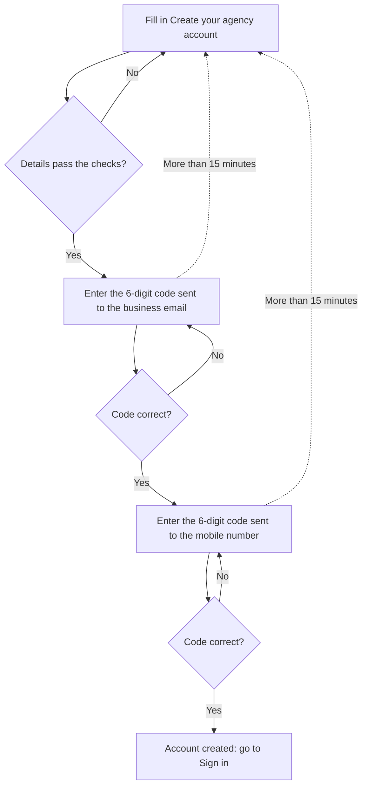

# Create an agency account

A tour agency signs up once to start publishing tours. Sign-up has three steps: enter the agency's details, confirm the business email with a code, then confirm the mobile number with a code. Checking both contacts means guests can trust who they're booking with.

**Who uses it:** the agency owner or the person setting Travel Ninja up for the agency · **Where to find it:** **Create an account** on the sign-in page

## The sign-up flow

## Step 1: Enter the agency's details

1. On the sign-in page, click **Create an account**.
2. Fill in the form. Every field is required:

   | Field                                 | What to enter                                                                                                                         |
   | ------------------------------------- | ------------------------------------------------------------------------------------------------------------------------------------- |
   | **Agency name**                       | The agency's trading name, as guests should see it                                                                                    |
   | **Contact person's name**             | The full name of the person responsible for the account                                                                               |
   | **Country**                           | Where the agency is based. **India** is chosen for you; change it if needed.                                                          |
   | **Business email**                    | The agency's work email. Codes and password-reset links go here.                                                                      |
   | **Mobile number**                     | The agency's mobile number, without the country code. The code (for example **+91**) is shown in the box from the country you picked. |
   | **Password** and **Confirm password** | A password for signing in, typed twice                                                                                                |

3. Tick **I agree to the Terms of Service and Privacy Policy**.
4. Click **Create account**.

If something is missing or wrong, the form shows a red message under that field and nothing is sent. Once the details are accepted, you move straight on to verifying the email.

## Step 2: Verify the business email

1. Check the business email inbox for a 6-digit code from Travel Ninja.
2. Type the code into the six boxes.
3. Click **Verify and continue**.

Typed the wrong email? Click **Change email** to go back to the form.

## Step 3: Verify the mobile number

1. Check the phone for a 6-digit code.
2. Type it in and click **Verify and continue**.

When the mobile number is confirmed, a green **Account created successfully** message appears and you're taken to the [sign-in page](./sign-in.md).

Typed the wrong number? Click **Change mobile number** to go back to the form.

## Didn't receive a code?

Click **Resend code** under **Didn't receive a code?**. A new code is sent and the message **A new code is on its way.** appears. You can ask again after 60 seconds; until then the page shows a countdown (**Resend code in 59s**).

## Business rules

- All fields on the form are required, and the terms must be accepted.
- **Agency name** and **Contact person's name** can be up to 100 characters.
- The **Business email** must look like a real email address (for example `name@agency.com`).
- The **Mobile number** takes digits only, and exactly as many as the chosen country uses. The box won't accept more.
- The **Password** needs at least 8 characters, with an uppercase letter, a lowercase letter, a number and a symbol. **Confirm password** must match it.
- Each verification code has 6 digits.
- Both codes must be entered within **15 minutes** of submitting the form. After that, sign-up starts again from the form.
- A new code can be requested once every 60 seconds.

## Messages you might see

| Message                                                               | What it means                                                                                                            | What to do                       |
| --------------------------------------------------------------------- | ------------------------------------------------------------------------------------------------------------------------ | -------------------------------- |
| **Agency name is required** (and similar under each field)            | A required field is empty                                                                                                | Fill it in                       |
| **Invalid email address**                                             | The email isn't in a valid format                                                                                        | Check for typos                  |
| **Mobile number must contain only numbers**                           | Spaces, dashes or letters were typed                                                                                     | Enter digits only                |
| **Mobile number must be _N_ digits**                                  | The number is too short for the chosen country                                                                           | Check the number and the country |
| **Password must contain at least one uppercase letter** (and similar) | The password doesn't meet a rule                                                                                         | Add what's missing               |
| **Passwords do not match**                                            | The two password boxes differ                                                                                            | Retype them                      |
| **You must accept the terms**                                         | The terms box isn't ticked                                                                                               | Tick it                          |
| **Enter all 6 digits of the code.**                                   | The code is incomplete                                                                                                   | Type all six digits              |
| **Error!** with a reason                                              | Travel Ninja couldn't accept the details or the code (for example, the email is already registered or the code is wrong) | Follow the reason given          |
| **Your verification session has expired. Please start again.**        | More than 15 minutes passed                                                                                              | Fill in the form again           |

## Related pages

- [Sign in and out](./sign-in.md)
- [Reset a forgotten password](./reset-password.md)

## Things to check when testing

- [ ] Submit the form empty: every field shows its message and nothing is sent.
- [ ] India is selected by default and the mobile box shows **+91**.
- [ ] Change the country: the dialling code and the allowed number of digits change with it.
- [ ] Each password rule (length, uppercase, lowercase, number, symbol) blocks the form when it isn't met.
- [ ] Different passwords show **Passwords do not match**.
- [ ] Submitting a valid form opens **Verify your email**, showing the email entered.
- [ ] A 5-digit code shows **Enter all 6 digits of the code.**
- [ ] A wrong code shows an **Error!** message and stays on the same step.
- [ ] **Resend code** shows **A new code is on its way.** and a 60-second countdown.
- [ ] A correct email code moves on to **Verify your mobile number**.
- [ ] A correct mobile code shows **Account created successfully** and opens the sign-in page.
- [ ] **Change email** and **Change mobile number** return to the form.
- [ ] Waiting more than 15 minutes before entering a code sends you back to the form.
