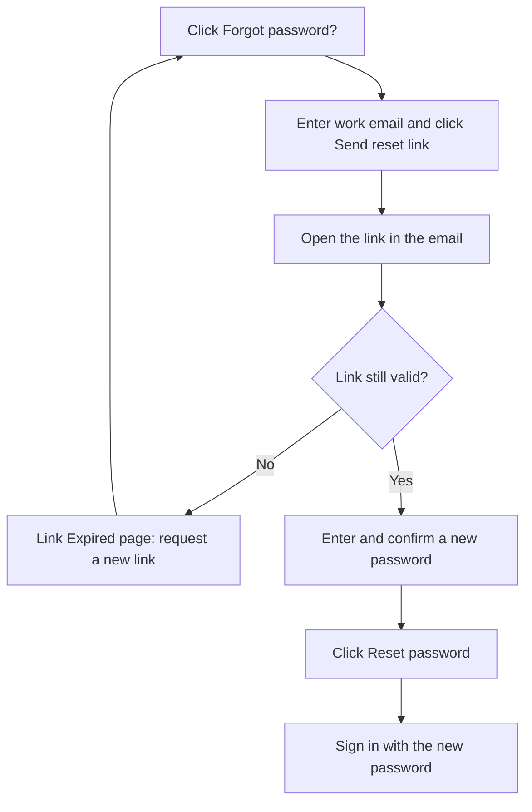

# Reset a forgotten password

If someone at the agency forgets their password, they can set a new one through a secure link sent to their work email, without contacting support.

**Who uses it:** anyone who can't sign in · **Where to find it:** **Forgot password?** on the sign-in page

## The reset flow

## How to reset your password

1. On the sign-in page, click **Forgot password?**.
2. Enter your **Work email** and click **Send reset link**.
   The message **Reset link sent! Check your email for instructions.** appears and you're returned to the sign-in page.
3. Open the email from Travel Ninja and click the link. The **Change your password** page opens.
4. Enter a **New password**, type it again in **Confirm password**, and click **Reset password**.
5. The message **Password reset successful** appears and you're taken to the sign-in page. Sign in with the new password.

Changed your mind? Click **Back to sign in**.

## If the link has expired

Reset links only work for a short time. An old or already-used link opens a **Link Expired** page:

> To reset password, return to the login page and select Forgot Password to send a new email

Click **Back to log in** and start again from step 1.

If you no longer have access to the business email, contact support.

## Business rules

- The work email must be a valid email address, up to 50 characters.
- A reset link works for a limited time only.
- The new password must be **8 to 12 characters** long, with at least one uppercase letter, one lowercase letter, one number, and one of these symbols: `@ $ ! % * ? &`.
- **Confirm password** must match the new password.

:::note
The rules for a new password here are stricter than the rules when [creating an account](./create-account.md), which allow longer passwords and any symbol.
:::

## Messages you might see

| Message                                                                   | What it means                                            | What to do                             |
| ------------------------------------------------------------------------- | -------------------------------------------------------- | -------------------------------------- |
| **Please enter email address** / **Invalid email address**                | The email is missing or badly formatted                  | Fix the email                          |
| **Reset link sent! Check your email for instructions.**                   | The link has been sent                                   | Check your inbox, and your spam folder |
| **Password must be at least 8 characters** (and the other password rules) | The new password breaks a rule                           | Adjust the password                    |
| **Password cannot exceed 12 characters**                                  | The new password is too long                             | Use 12 characters or fewer             |
| **Passwords don't match**                                                 | The two boxes differ                                     | Retype them                            |
| **Link Expired**                                                          | The link is too old or has been used                     | Request a new link                     |
| **Error!** with a reason                                                  | Travel Ninja couldn't send the link or save the password | Follow the reason given                |

## Related pages

- [Sign in and out](./sign-in.md)

## Things to check when testing

- [ ] An empty or badly formatted email is blocked with a message.
- [ ] A valid email shows **Reset link sent!…** and returns to the sign-in page.
- [ ] The emailed link opens **Change your password**.
- [ ] Each password rule blocks the form when it isn't met, including more than 12 characters and a symbol outside `@ $ ! % * ? &`.
- [ ] Different passwords show **Passwords don't match**.
- [ ] A valid new password shows **Password reset successful** and opens the sign-in page, and the new password works.
- [ ] Reusing the same link, or using an old one, shows **Link Expired**.
- [ ] **Back to sign in** and **Back to log in** both return to the sign-in page.
