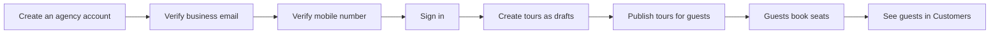

# Travel Ninja documentation

Travel Ninja is an online back office for Indian tour operators. An agency uses it to publish its tour departures, fill the seats on them, and keep track of the guests who book. It replaces the spreadsheets and chat threads that agencies usually juggle with one place for tours, bookings and customers.

## Who these docs are for

| Reader                                                                         | Start here                                                                                                                                           |
| ------------------------------------------------------------------------------ | ---------------------------------------------------------------------------------------------------------------------------------------------------- |
| **Tour operators** who use Travel Ninja every day                              | [Getting started](./getting-started/create-account.md), then the [User guide](./user-guide/navigation.md)                                            |
| **PMO and business stakeholders** who need to know what the product does today | This page, then each module's opening section                                                                                                        |
| **The testing team**, who check each release                                   | Each page's _Things to check when testing_ list, the [Release notes](./release-notes.md) and [How to report a bug](./testing/how-to-report-a-bug.md) |

## The business journey

An agency signs up once, proves its email and mobile number are real, and then works in Travel Ninja day to day.

Verification protects guests: they can trust that the agency they book with is real.

## The modules at a glance

| Module                                                 | What it's for                                                       | Status                     |
| ------------------------------------------------------ | ------------------------------------------------------------------- | -------------------------- |
| [Getting started](./getting-started/create-account.md) | Create an agency account, sign in, and recover a forgotten password | Available                  |
| [Finding your way around](./user-guide/navigation.md)  | The side menu, page header, dark mode and signing out               | Available                  |
| [Dashboard](./user-guide/dashboard.md)                 | The landing page after signing in                                   | Welcome page only, for now |
| [Tours](./user-guide/tours.md)                         | Create, edit, search and delete the agency's tour departures        | Available                  |
| [Bookings](./user-guide/bookings.md)                   | See and filter the bookings guests have made                        | Preview with sample data   |
| [Customers](./user-guide/customers.md)                 | Look up the guests who have booked, with their spend and last trip  | Available                  |

The side menu also lists **Calendar**, **Availability**, **Messages**, **Reviews**, **Tour performance**, **Revenue**, **Settings** and **Billing & payouts**. These are planned and don't have screens yet. See [Finding your way around](./user-guide/navigation.md#menu-items-that-are-coming-soon).

## Terms used in these docs

Words such as _tour_, _departure_, _draft_ and _occupancy_ have a specific meaning in Travel Ninja. The [Glossary](./glossary.md) defines them.
