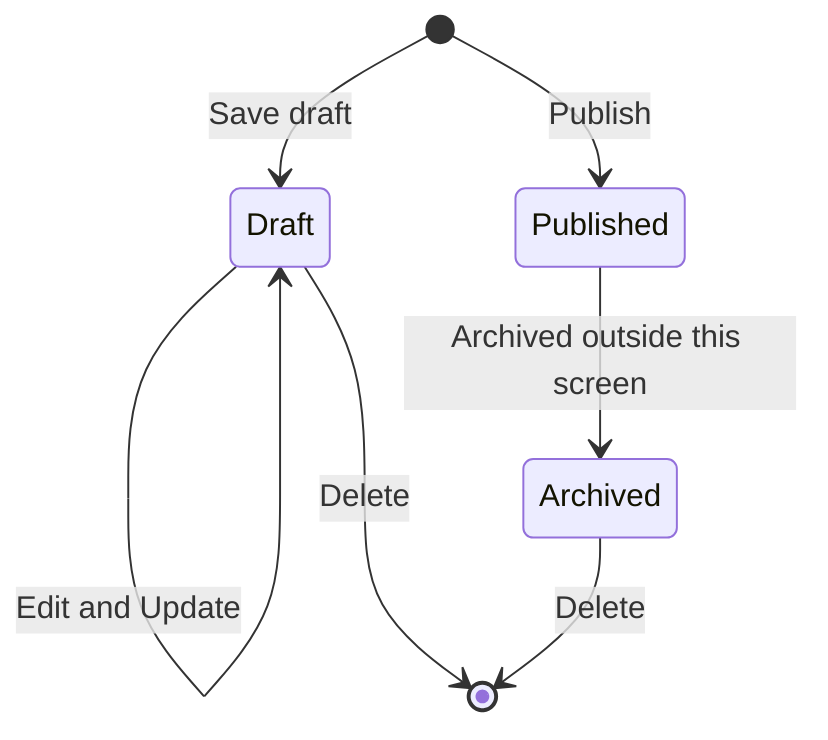

# Tours

A tour is a trip the agency sells: one departure with its dates, price, seats, guide, itinerary and photos. The Tours module is where the agency builds tours, keeps them as drafts until they're ready, publishes them for guests, and removes the ones it no longer needs.

**Who uses it:** agency owners and operations staff who plan trips · **Where to find it:** **Tours** in the side menu

## What you can do here

- See all the agency's tours at a glance, with seats sold and occupancy
- Find a tour by name or destination, status or category
- Create a new tour and save it as a draft or publish it straight away
- Edit a draft tour
- Delete a tour that isn't live

## A tour's life

| Status        | What it means                        | What you can do                              |
| ------------- | ------------------------------------ | -------------------------------------------- |
| **Draft**     | Being prepared. Guests can't see it. | **Edit**, delete                             |
| **Published** | Live: guests can find and book it    | **View** only. A live tour can't be deleted. |
| **Archived**  | No longer on sale                    | **View**, delete                             |

## The tour cards

Each card shows the cover photo with the place name on it, the tour's title and status, and its destination, plus:

| On the card   | What it means                                                                                      |
| ------------- | -------------------------------------------------------------------------------------------------- |
| **Departure** | The date the tour leaves                                                                           |
| **Price**     | Price per person, in rupees                                                                        |
| **Capacity**  | Seats booked out of the seats available, for example **12/16**                                     |
| **Occupancy** | The share of seats sold, for example **75%**. Shows **—** when there's no booking information yet. |

The footer shows **Showing _x_ of _y_** tours, with page buttons when there's more than one page.

## How to find a tour

1. Type part of a tour's name or destination into **Search tours or destinations...**. The list updates once you stop typing.
2. Narrow it down with the **All statuses** and **All categories** drop-downs.
3. Clear the search box, or choose **All statuses** / **All categories**, to see everything again.

Search and the filters work together. Changing either takes you back to the first page. The page address keeps your search, filters and page, so you can bookmark or share a filtered list, and the browser's **Back** button returns to your previous filters.

## How to create a tour

1. Click **New tour**. The **Create tour** screen opens.
2. Fill in its sections (on a computer, **Schedule & pricing** sits in a column on the right):

   **Basics**
   - **Tour title** (required) and **Destination** (required)
   - **Category** (required): pick from the list
   - **Description**: what the trip is about

   **Cover & gallery**
   - **Cover image**: drag a photo onto the box, or click to browse. Wide photos with the subject in the centre work best, as tour cards crop to a wide banner. Use **Replace** or **Remove** to change it.
   - **Gallery**: click **Add photo** to add photos of the stays, food and highlights. You can pick several at once.

   **Itinerary**
   - One block per day, each with a **Title**, **Location** and **Description**. All three are required.
   - **Add day** adds the next day, and **Remove** deletes a day.

   **Inclusions & policy**
   - **Inclusions**, **Exclusions** and **Cancellation policy**, written for guests.

   **Schedule & pricing**
   - **Duration (days)**, **Departure date** and **Return date**
   - **Price per person (INR)** and **Capacity** (the number of seats)
   - **Guide label**: the guide leading the tour

3. Choose how to save:
   - **Save draft** keeps the tour hidden from guests so you can finish it later. The message **Draft saved** appears.
   - **Publish** puts the tour live for guests straight away. The message **Tour published** appears.

Either way you're returned to the Tours list. If a field is missing or wrong, a red message appears under it and nothing is saved.

## How to edit a draft

1. Find the draft and click **Edit** on its card. The **Edit tour** screen opens, showing the tour's title and **Draft**.
2. Change what you need.
3. Click **Update**. The message **Tour updated** appears and you're returned to the Tours list.

Clicking **Update** without changing anything shows **No changes to save**. Editing doesn't change the tour's status: a draft stays a draft.

## How to delete a tour

1. Click the bin icon on a draft or archived tour's card. Published tours don't have one.
2. Read the confirmation and click **Delete tour**, or **Cancel** to keep it.

The message **Tour deleted** appears and the tour disappears from the list. If it was the only tour on a later page, you're moved back a page.

## Business rules

- **Tour title** and **Destination** are required, up to 120 characters each. **Category** is required.
- **Description**, **Inclusions**, **Exclusions** and **Cancellation policy** are optional, up to 2,000 characters each.
- Photos must be JPG, PNG or WebP, and 5 MB or smaller. The gallery holds up to 10 photos.
- A tour needs at least one itinerary day. Each day needs a title and location (up to 100 characters) and a description (up to 2,000).
- **Duration (days)** is a whole number, at least 1.
- **Departure date** and **Return date** are required, and the return can't be before the departure.
- **Price per person (INR)** can't be negative. **Capacity** is a whole number, at least 1.
- A guide must be picked.
- **Save draft** and **Publish** both check every rule above. A draft can't be saved half-finished.
- Only drafts can be edited. Published tours can't be deleted.

## Messages you might see

| Message                                                                            | What it means                                  | What to do                                    |
| ---------------------------------------------------------------------------------- | ---------------------------------------------- | --------------------------------------------- |
| **No tours yet**                                                                   | The agency hasn't created any tours            | Click **New tour**                            |
| **No tours match your filters**                                                    | Nothing matches the search, status or category | Try different terms or clear the filters      |
| **No tours on this page**                                                          | The page number is past the last page          | Go back a page                                |
| **We couldn't load your tours**                                                    | The list couldn't be loaded                    | Check your connection and click **Try again** |
| **Enter a tour title**, **Pick a category**, **Pick a departure date** and similar | A required field is empty                      | Fill it in                                    |
| **Return date can't be before departure**                                          | The dates are the wrong way round              | Fix the dates                                 |
| **Use a JPG, PNG or WebP image** / **Images must be 5 MB or smaller**              | The photo can't be used                        | Pick another photo                            |
| **The gallery holds up to 10 photos**                                              | The gallery is full                            | Remove a photo first                          |
| **Add at least one day**                                                           | The itinerary is empty                         | Click **Add day**                             |
| **Draft saved** / **Tour published** / **Tour updated**                            | The tour was saved                             | Nothing to do                                 |
| **No changes to save**                                                             | **Update** was clicked with nothing changed    | Nothing to do                                 |
| **We couldn't update this tour** / **We couldn't delete this tour**                | The change didn't go through                   | Try again. If it keeps happening, report it.  |
| **Error!** with a reason                                                           | Travel Ninja didn't accept the tour            | Follow the reason given                       |

## Known limitations

- **View** on a published or archived tour opens a **This trail doesn't exist** page. The read-only tour view isn't built yet.
- A saved draft can't be published yet: **Edit** keeps it as a draft. To publish, create the tour with **Publish**.
- Tours can't be archived from this screen.
- The **Guide label** list is a fixed sample (Arjun Mehta, Priya Nair, Rahul Sharma) until the agency's own guides are available.
- The description under the **Tours** heading always names **Wanderly Travels**.

## Related modules

- [Bookings](./bookings.md): guests book seats on published tours.
- [Customers](./customers.md): each guest's last trip links back to a tour.

## Things to check when testing

- [ ] Cards show the right status badge, and **Edit** on drafts, **View** on published and archived tours.
- [ ] The bin icon shows on drafts and archived tours only, never on published ones.
- [ ] **Capacity** shows booked/total and **Occupancy** the matching percentage, or **—** with no booking data.
- [ ] Search matches by title and destination; status and category filters combine with it.
- [ ] Changing the search or a filter returns to page 1; the page address keeps the filters, and **Back** restores the previous ones.
- [ ] An empty agency shows **No tours yet**; a search with no results shows **No tours match your filters**.
- [ ] **New tour**, then **Save draft** with an empty form, shows a message on every required field.
- [ ] Return date before departure date shows **Return date can't be before departure**.
- [ ] Photos over 5 MB, or in another format, are refused with a message; an 11th gallery photo is refused.
- [ ] **Save draft** creates a **Draft** and **Publish** creates a **Published** tour, each with its message.
- [ ] Editing a draft and clicking **Update** shows **Tour updated**; with no change, **No changes to save**.
- [ ] Deleting asks for confirmation; **Cancel** keeps the tour, **Delete tour** removes it and shows **Tour deleted**.
- [ ] Deleting the only tour on the last page moves back one page.
